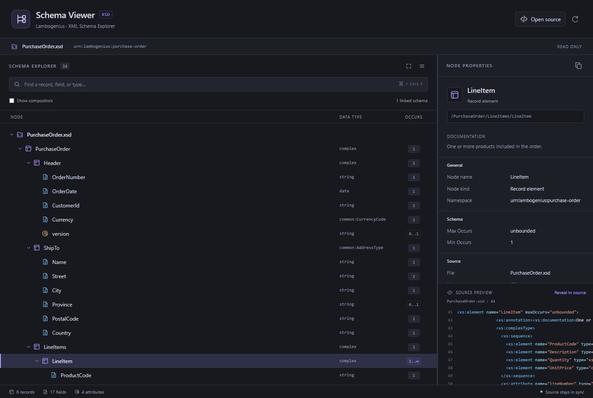

# Lambogenius XSD Viewer

A VS Code extension for exploring XML schemas in a BizTalk-inspired record and field tree. Select a node to see its properties, restrictions, BizTalk annotations, and original XSD.



## Install and open a schema

Requires VS Code 1.96 or later.

1. In VS Code, run **Extensions: Install from VSIX…** and choose `releases/biztalk-xsd-viewer-0.1.0.vsix`.
2. Right-click an `.xsd` file in Explorer and choose **XSD Viewer: Open Schema**.
3. Select records, elements, or attributes to inspect their properties. Double-click a node to jump to its source.

You can also use **Reopen Editor With… → XSD Schema Viewer**, or run **XSD Viewer: Open Schema** from the Command Palette. The ordinary text editor remains the default; use **Configure default editor** in VS Code's editor picker if you prefer to always open XSDs visually.

Run **XSD Viewer: Open Example Schema** for a purchase order example with imported types, repeated line items, a payment choice, and BizTalk annotations.

## Features

- Record and field tree with distinct icons for elements, attributes, types, groups, and choices.
- Data types and occurrence badges: `1`, `0..1`, and `1..∞`.
- Grouped properties, documentation, enumerations, restrictions, namespaces, defaults, and fixed values.
- BizTalk `appinfo` annotations, including flat file and promoted-field metadata when present in the XSD.
- Named complex and simple types, element references, model groups, attribute groups, and type extensions.
- Relative local `include` and `import` resolution, including cyclic imports and chameleon includes.
- Optional compositor nodes, expand/collapse controls, and search across names, types, paths, and documentation.
- Namespace-aware **Copy XPath**, a source preview, and **Open source** alongside the viewer.
- Refreshes when the source or a resolved dependency changes. Unsaved edits in open text documents are included.
- VS Code theme colors, keyboard navigation, a resizable properties pane, and a stacked layout in narrow editor groups.

## Keyboard

| Key | Action |
| --- | --- |
| Up / Down | Select the previous / next visible node |
| Right / Left | Expand / collapse a node, or move to its child / parent |
| Home / End | Select the first / last visible node |
| Enter / Space | Select a focused node |
| Ctrl+F / Cmd+F | Focus schema search |
| Escape in search | Clear search and return to the tree |
| Left / Right on the pane divider | Resize the properties pane |

## Scope and limits

This version is a **read-only viewer**. Edit the original XSD with **Open source**; the tree refreshes automatically. It is not an XSD compiler, XML instance validator, or complete replacement for BizTalk's schema designer.

The viewer focuses on XSD 1.0 structures. XSD 1.1 assertions and identity constraints are summarized as source-defined constraints. `redefine` and `override` produce a notice and are not expanded. Restriction facets are displayed, but are not evaluated or merged into an effective validation model. Compositor occurrence badges describe the declaration at that node; they do not compute a field's effective cardinality through nested groups or choices.

Dependencies must use relative paths inside the open workspace containing the schema, or inside the schema's folder when there is no workspace. Remote URLs and absolute locations are not followed. Unresolved references appear as notices. The viewer does not upload schemas, execute annotation content, load DTDs, or resolve external XML entities. Its runtime has no telemetry or network requests.

To keep large schemas manageable, parsing is limited to 4 MB and 100,000 XML nodes per file, with 256 levels of XML nesting. Dependency resolution is limited to 32 schemas and 16 MB in total. The displayed tree is limited to 12,000 nodes and 40 expansion levels. Recursive references are marked and bounded.

## Develop

```powershell
npm ci
npm run check
npm test
npm run build
```

Press **F5** to launch an Extension Development Host, then run **XSD Viewer: Open Example Schema**.

```powershell
npm run test:ui
npm run test:extension
npm run package
```

The browser checks use an installed Microsoft Edge in a separate headless profile. Set `XSD_TEST_BROWSER=chrome` to use an installed Chrome instead. Screenshots are written to `artifacts/`.

The extension host smoke test uses an installed Windows VS Code in isolated `.test-temp/` user and extension directories. Set `VSCODE_EXECUTABLE` to override its executable. The test launch uses Electron's `--no-sandbox` flag to accommodate test environments; this is only a test harness setting. It checks activation, command registration, custom-editor opening, and source document selection. Browser checks exercise the webview using a VS Code message bridge fixture.

Packaging produces `releases/biztalk-xsd-viewer-0.1.0.vsix`. The runtime XML parser is bundled, so the extension needs no separate npm installation.

## Design references

The extension uses VS Code's [Custom Editor API](https://code.visualstudio.com/api/extension-guides/custom-editors). Its schema tree and property inspector take inspiration from Microsoft's [BizTalk Editor](https://learn.microsoft.com/en-us/biztalk/core/using-biztalk-editor) and [node properties](https://learn.microsoft.com/en-us/biztalk/core/node-properties). This is an independent extension and does not require BizTalk Server.

MIT license. See `THIRD_PARTY_NOTICES.txt` for bundled dependencies.
